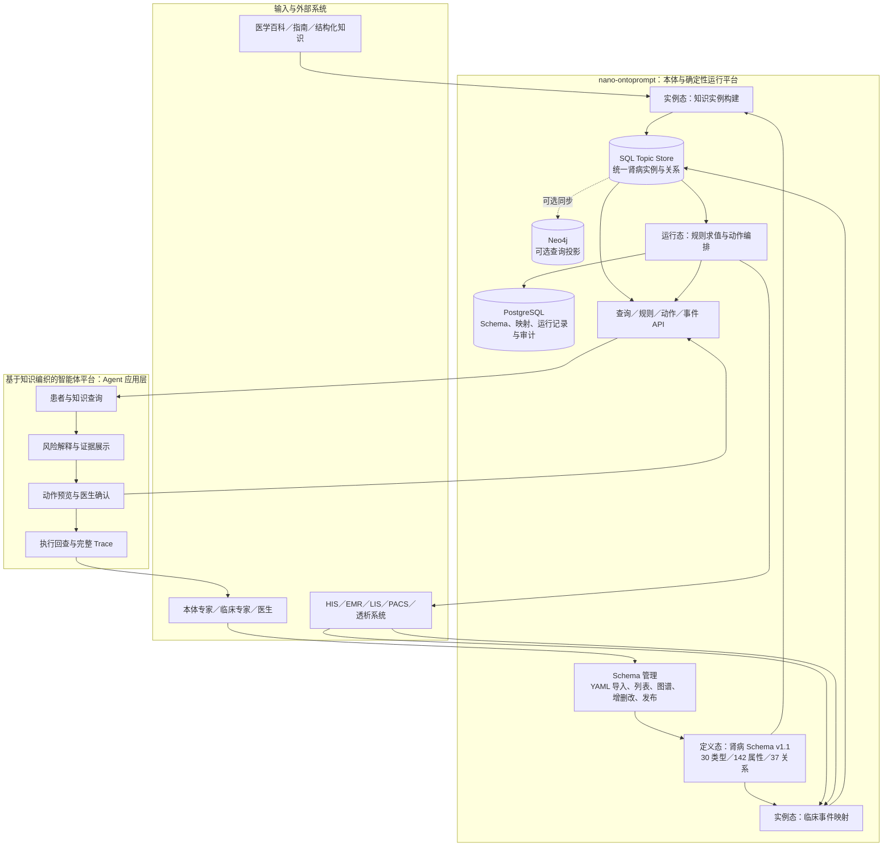
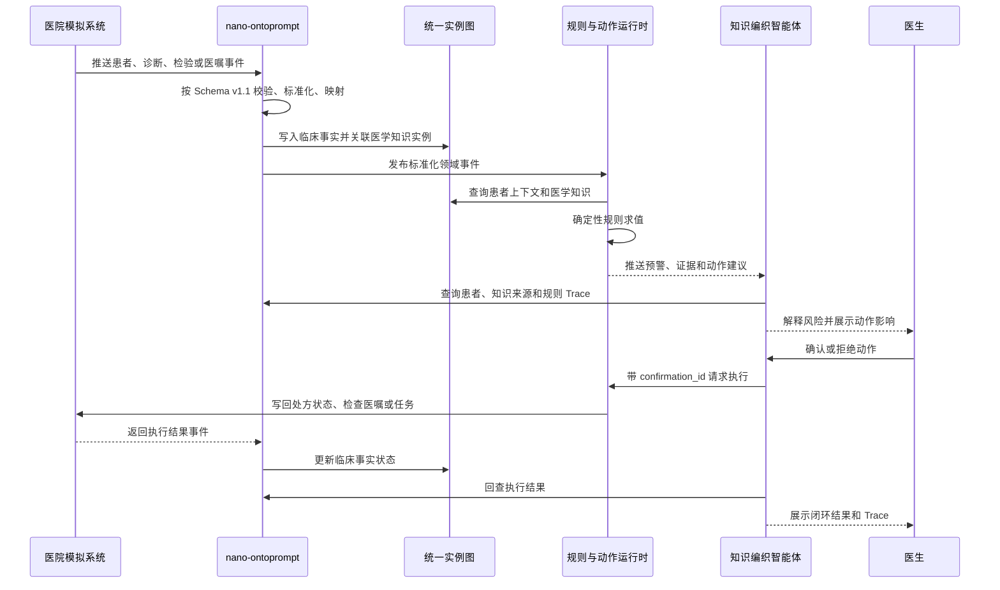
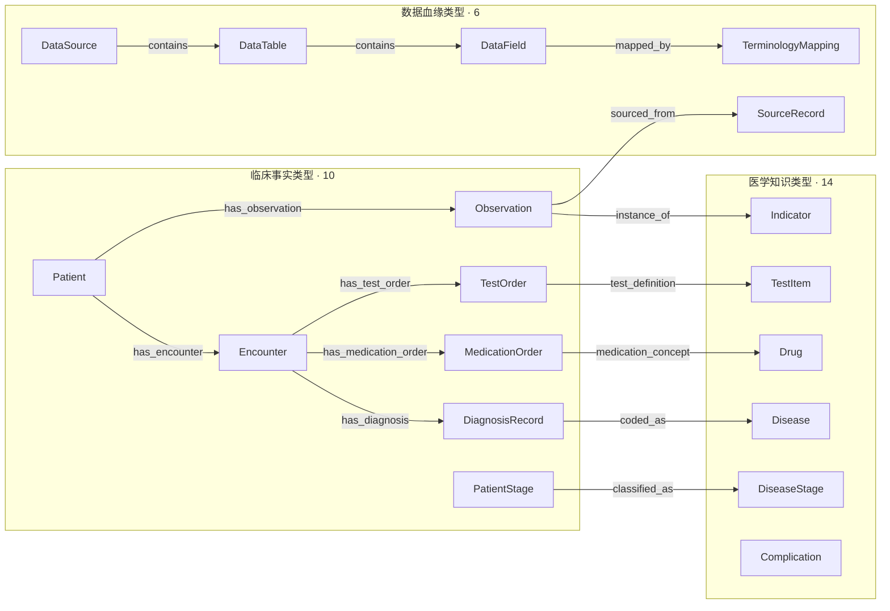
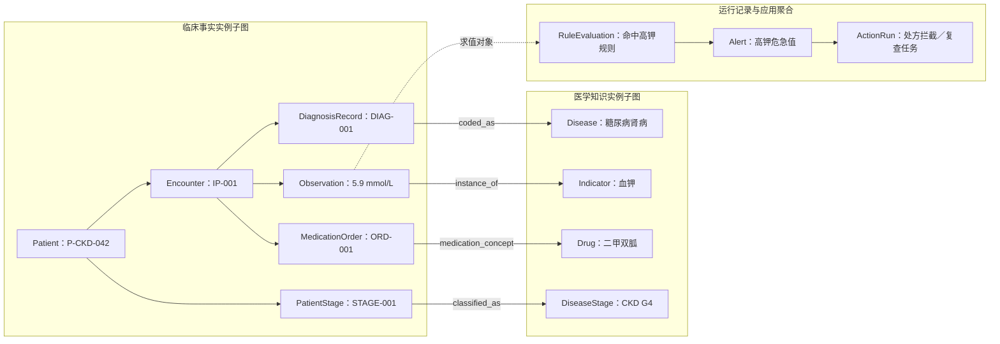
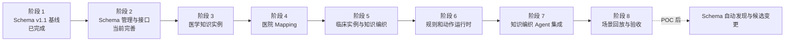

# 肾病本体构建与 Agent 应用 POC 实施方案

## 1. 文档目标

本文定义 `nano-ontoprompt（知识编织平台）` 与 `ontopilot（基于知识编织的智能体平台）` 两个工程联合实现肾病本体 POC 的功能边界、核心模型、端到端流程、外部系统模拟、实施步骤和验收标准。

POC 暂不包含科研取数，重点完成：

1. 以医学知识和医院临床业务需求为依据，维护并发布已定义的肾病本体 Schema v1.1；本期不自动生成 Schema。
2. 支持业务专家通过列表、图谱和 YAML 对 Schema 进行查看、编辑和发布。
3. 使用医学知识数据和医院临床数据填充图谱实例，并完成两类知识的融合。
4. 基于实时临床事件执行规则，生成预警、任务和动作建议。
5. 通过“基于知识编织的智能体平台”的 Agent 完成查询、解释、确认、执行和回查闭环。

当前基线状态：

| 能力 | 当前状态 | 本 POC 后续工作 |
|---|---|---|
| 肾病 Schema v1.1 | 已导入并发布 | 根据实例和场景反馈迭代版本 |
| Schema 列表、图谱与分类筛选 | 已实现 | 补充规则/动作详情及发布校验 |
| Schema 增删改和 YAML 导入 | 已实现 | 补充版本差异与回滚策略 |
| 医学知识与临床实例 | POC 已完成 | 提供可重复安装的 P-CKD-042 知识、临床事实和待检查数据 |
| 知识主题运行 API | POC 已完成 | Manifest、对象查询、关系遍历、规则求值和动作执行均以发布主题为边界 |
| 规则、动作与 Agent 闭环 | POC 已完成 | 9 条规则、5 个动作；风险报告及跨工程确认/拒绝/模拟执行已通过 E2E |

### 1.1 当前可运行 POC 基线（2026-10-01）

当前主闭环已经实际走通，不再只是设计目标：

```text
Schema v1.1 发布
→ 旧医学知识实例对齐
→ P-CKD-042 医学知识、临床事实和检查任务实例
→ nano 发布 Topic Manifest（Schema／规则／动作／权限／版本）
→ 智能体后端按用户令牌读取选中知识主题
→ 9 条发布规则经 Nano 统一规则端点求值
→ Agent 调用通用对象上下文与主题规则工具
→ 大模型仅依据当前主题实际返回的对象、关系和规则证据组织回答
→ 动作预览并生成 confirmation_id
→ 用户确认或拒绝
→ Nano 模拟执行适配器写入 ActionRun
→ 智能体展示执行状态和可审计 Trace
```

live 验证结果：Schema v1.1 共 30 个类型、37 个关系、9 条规则和 5 个动作。P-CKD-042 实测命中 CKD G4、高钾、二甲双胍禁用、ARB 高钾复核、SGLT2i 不宜启动、非奈利酮暂缓和 CKD4 入院评估；二甲双胍动作已完成 `pending_confirmation → completed`。Neo4j 是可选查询投影，不可用时 SQL 主题运行 API 和完整 POC 仍可启动。

POC 使用 Nano 中已发布的「肾病临床安全与入院评估」知识主题（ID `428ece7e-7a9f-47b2-861d-572fca2d2162`）。`P-CKD-042` 及其检验、医嘱、待完成检查是该主题下的可重复验收实例，不是另一个知识主题，也不替代用户已编织的数据。运行时使用 Nano 登录令牌访问两个后端，不再使用跨系统 SSO 跳转或由浏览器传入角色。

当前跨工程契约如下：

| Nano 运行接口 | 用途 |
|---|---|
| `GET /agent-runtime/topics` | 列出当前用户可使用的已发布知识主题 |
| `GET /agent-runtime/topics/{id}/manifest` | 返回 Schema、关系、规则、动作、权限与版本指纹 |
| `POST /agent-runtime/topics/{id}/events:ingest` | 按当前 Schema 的对象类型幂等接入任意业务事件，并可触发规则重算 |
| `POST /agent-runtime/topics/{id}/objects:query` | 按 Schema 类型和原始属性名查询主题实例 |
| `GET /agent-runtime/topics/{id}/objects/{object_key}/context` | 用任意实例 ID、名称或标识属性读取对象及一跳关系上下文 |
| `POST /agent-runtime/topics/{id}/graph:traverse` | 遍历主题实例关系 |
| `POST /agent-runtime/topics/{id}/rules:evaluate` | 用发布规则进行确定性求值，返回条件、证据和建议动作 |
| `POST /agent-runtime/topics/{id}/actions:preview` | 生成动作影响预览和 `confirmation_id` |
| `POST /agent-runtime/topics/{id}/actions:commit` | 确认或拒绝，并由可替换执行适配器处理 |
| `GET /agent-runtime/topics/{id}/action-runs/{run_id}` | 回查动作状态、前后快照和副作用 |

智能体后端不再按规则名查找本地硬编码 `FunctionRegistry`。`Manifest.rules[].executor_key` 只作为远程规则标识，所有求值都回到 Nano；动作同样不执行 Schema 中的任意代码字符串，而是经过预览、权限、确认和执行适配器。当前适配器为模拟实现，后续替换为 EMR/HIS/任务系统连接器时对 Agent 和前端契约无影响。

### 1.2 平台通用性边界

两个工程的平台代码只认识以下元对象：知识主题、对象类型、对象、属性、关系、规则、动作、事件和执行记录。平台运行时不得出现 `Patient`、`patient_id`、疾病、药物、检验等行业专用字段或类型映射，也不得按某一行业的命名猜测对象语义。

- 行业 Schema、字段、规则表达式和实例值只存在于 Nano 的主题配置与主题数据中。
- 对象定位统一使用 `object_key/object_id`；Nano 根据当前主题实例的 ID、名称或任意标量属性匹配。
- Agent 工具统一为 `get_object_context`、`object_query`、`traverse_topic_graph`、`evaluate_object_rules`、动作预览与执行。
- 结构化编织建议只比较来源字段与当前 Schema 属性，不按患者、疾病或其他行业关键词做特殊推断。
- 类型 `category` 是用户可定义的自由标签，平台不再限制为固定三分类。
- 本文后续肾病名称均是当前 POC 的主题数据与验收示例，不是平台内置模型，也不会影响其他行业主题。

## 2. 核心认识与概念边界

### 2.1 不单独建设“统一元模型 Schema”

本 POC 只建设一套面向肾病业务的本体 Schema。

此前提到的“统一元模型”不应作为一套需要单独抽取、展示和发布的业务本体。它只是 `nano-ontoprompt` 内部保存本体定义所需的技术结构，例如：

- 实体类型如何保存；
- 属性如何描述数据类型、是否必填、单位和主键；
- 关系如何描述起点、终点、方向和基数；
- 规则、动作如何关联实体类型和属性；
- Schema 如何记录版本和发布状态。

这些技术结构属于平台实现，不是肾病领域用户需要额外构建的一层本体，也不作为 POC 的独立阶段。

### 2.2 POC 中只有一套肾病本体 Schema

肾病本体 Schema 本质上是一张完整的类型图：

- 图中的节点是实体类型，例如 `Disease`、`Patient`、`Observation`；
- 节点属性是类型的属性定义，例如 `Observation.value`、`Observation.unit`；
- 图中的边是关系类型，例如 `Observation instance_of Indicator`；
- 规则定义和动作定义是挂接在类型、属性和关系上的行为定义。

它是一套完整定义，包含：

- 实体类型；
- 实体属性；
- 关系类型；
- 规则定义；
- 动作定义；
- 数据来源和字段映射；
- 必要的状态定义。

Schema 的形成依赖两类输入：

1. 通用医学知识：医学百科、指南、疾病库、指标库、症状库、药物知识等。
2. 医院临床实际数据：HIS、EMR、LIS、PACS、透析系统的表结构、字段、编码、样例数据和实时事件。

系统从这些输入中提取候选实体类型、属性和关系，再由业务专家确认、编辑、合并并发布。

Schema 不物理拆成“医学知识 Schema”“临床 Schema”“运行 Schema”。为了让一张较大的图容易理解，可以在实体类型定义上增加分类元数据 `category`：

| `category` | 含义 | 示例 |
|---|---|---|
| `medical_knowledge` | 稳定的医学概念类型 | Disease、Indicator、Drug |
| `clinical_fact` | 患者实际业务记录类型 | Patient、Observation、MedicationOrder |
| `data_lineage` | 来源、映射和血缘类型 | DataSource、DataField、LineageRecord |

这个分类是实体类型自身的标签/元数据，不是实体类型的业务属性，更不是实例属性。它仅用于列表分组、图形着色和视图过滤，不会写入疾病、患者或检查结果实例，不形成不同 Schema，不影响类型之间建立关系，也不要求使用不同数据库。

### 2.3 Schema 与实例数据的边界

Schema 描述“允许存在什么，以及它们如何关联”；实例描述“当前实际存在什么”。

| 内容 | 示例 | 归属 |
|---|---|---|
| 实体类型 | Patient、Observation、Drug | Schema |
| 属性定义 | Observation.value、Observation.unit | Schema |
| 关系类型 | Patient has_observation Observation | Schema |
| 医学知识概念 | 慢性肾脏病、血钾、二甲双胍 | 实例数据：知识实例 |
| 临床事实 | P-CKD-042、血钾 5.9、某次处方 | 实例数据：临床实例 |
| 规则定义 | 血钾 > 5.5 时触发高钾危急值 | Schema |
| 规则执行结果 | P-CKD-042 在 09:10 命中高钾规则 | 运行数据：RuleEvaluation |
| 动作定义 | 拦截二甲双胍处方 | Schema |
| 动作执行记录 | 处方 ORD-001 被拦截 | 运行数据：ActionRun |

### 2.4 规则和动作的归属意见

规则和动作不能简单地全部归为 Schema 或全部归为实例，需要区分定义态与运行态。

#### 属于 Schema 的内容

- `RuleDefinition`：规则名称、适用对象、触发事件、条件表达式、严重程度、引用属性和输出类型。
- `ActionDefinition`：动作名称、目标对象、参数、前置条件、产生的影响、是否需要确认、允许角色和执行通道。

它们属于本体的行为语义层，回答：

- 某种数据变化应当怎样判断；
- 某种结论能够触发什么动作；
- 动作会修改或创建什么对象。

#### 属于运行数据的内容

- `RuleEvaluation`：某条规则针对某患者、某次事件的求值结果；
- `Alert`：规则命中后产生的具体预警。
- `ClinicalTask`：需要在具体时限内完成的任务。
- `ActionRun`：某动作针对具体对象的一次执行记录。
- `Confirmation`：医生对具体动作的确认或拒绝记录。

这些内容首先是运行数据库中的业务记录，不要求都成为本体 Schema 中的实体类型。POC 中采用以下原则：

- `RuleDefinition` 和 `ActionDefinition` 随 Schema 发布；
- `RuleEvaluation`、`Alert`、`ClinicalTask`、`ActionRun`、`Confirmation` 保存到 PostgreSQL 运行表；
- 为支持 Agent 查询和融合图展示，可将必要字段以只读运行节点或虚拟节点投影到 Neo4j；
- 投影不改变本体 Schema，也不把全部日志永久复制为知识图节点。

因此不再设置抽象的“运行闭环模块”。运行闭环是 Schema 之上的业务运行机制，而不是必须单独构建的一块本体。

### 2.5 “跨层关系”不是独立模块

“跨层关系”也不是独立 Schema 或独立图。它只是同一张 Schema 图中连接不同类别实体类型的普通关系。

例如：

```text
DiagnosisRecord coded_as Disease
Observation instance_of Indicator
MedicationOrder medication_concept Drug
```

其中左侧属于临床事实类型，右侧属于医学知识类型。关系 `coded_as`、`instance_of`、`medication_concept` 与其他关系一样，有明确的起点类型、终点类型、方向和基数。

这些关系是必须的，因为没有它们只能得到两张互不关联的实例图，无法从患者血钾结果找到“血钾”知识概念、适用规则和动作。必须的是关系语义本身，不是一个名为“跨层关系模块”的系统功能。

## 3. 总体架构

整体采用“定义态、实例态、运行态、应用态”四层架构。`nano-ontoprompt` 负责前三层及对外能力，`基于知识编织的智能体平台` 负责应用态；两个工程不直接共享数据库，通过版本化 API、事件和 Trace 标识协作。



架构中的三个重要边界：

1. Schema 是定义态基础，不与具体实例混存为同一种对象。
2. 医学知识实例和临床事实实例写入同一实例图，通过普通语义关系编织；“融合应用图”只是查询视图，不是第三份图。
3. 规则和动作的定义随 Schema 发布，具体求值、预警、任务、确认和执行结果属于运行态。

### 3.1 两个工程的调用关系



## 4. 肾病本体 Schema 图及其逻辑分类

### 4.1 Schema 图的实际结构

Schema 在系统中保存为一张类型图，而不是三套模块化 Schema。

当前已发布基线为 `协和肾病本体建模 v1.1`，包含 30 个类型、142 个属性、37 个关系、9 条规则定义和 5 个动作定义。30 个类型上的 `category` 分布为：医学知识 14、临床事实 10、数据血缘 6。



上图只展开核心节点。三个分组是同一套 Schema 中类型的展示分类，不是三个子 Schema。`category` 是 `OntologyType` 的分类元数据，不是 `Disease`、`Observation` 等实例需要填写的业务属性。

每个类型节点至少包含：

```json
{
  "type_id": "Observation",
  "display_name": "检验/测量结果",
  "category": "clinical_fact",
  "properties": [
    {"name": "value", "data_type": "number", "required": true},
    {"name": "unit", "data_type": "string", "required": true},
    {"name": "sample_time", "data_type": "datetime", "required": true}
  ],
  "status": "published",
  "version": 1
}
```

每个关系类型至少包含：

```json
{
  "relation_id": "observation_instance_of_indicator",
  "name": "instance_of",
  "source_type": "Observation",
  "target_type": "Indicator",
  "source_cardinality": "many",
  "target_cardinality": "one",
  "status": "published",
  "version": 1
}
```

`category` 只控制展示分组和颜色。任何类别的类型都可以通过 Schema 中明确定义的关系连接。

### 4.2 核心实体类型

#### 医学知识类型

- `Disease`：疾病类型，实例包括慢性肾脏病、糖尿病肾病等标准疾病；
- `DiseaseStage`：疾病分期类型，实例包括 CKD G1-G5、AKI 1-3 期；
- `Symptom`：症状类型，实例包括水肿、少尿、血尿；
- `Indicator`：医学指标类型，实例包括血钾、Scr、eGFR、UACR；
- `TestItem`：检查/检验项目类型，实例包括肾动态显像、心脏超声、肾功能；
- `Drug`：药物类型，实例包括二甲双胍、厄贝沙坦、非奈利酮；
- `DrugClass`：药物类别；
- `Treatment`：治疗方案类型；
- `Procedure`：标准医疗操作类型；
- `Complication`：并发症类型；
- `RiskFactor`：风险因素；
- `BodyPart`：身体部位；
- `Guideline`：指南或规范；
- `Formula`：计算公式。

#### 临床事实类型

- `Patient`：脱敏患者；
- `Encounter`：门诊或住院就诊；
- `DiagnosisRecord`：患者诊断记录；
- `Observation`：某患者某时刻的检验或测量结果；
- `MedicationOrder`：具体药物医嘱；
- `TestOrder`：具体检查/检验医嘱；
- `ImagingReport`：检查报告；
- `DialysisSession`：透析记录；
- `ProcedureRecord`：操作记录。

#### 数据来源与血缘类型

- `DataSource`；
- `DataTable`；
- `DataField`；
- `SourceRecord`；
- `LineageRecord`；
- `TerminologyMapping`。

### 4.3 关键关系类型

- `Patient has_encounter Encounter`
- `Encounter has_diagnosis DiagnosisRecord`
- `DiagnosisRecord coded_as Disease`
- `Patient has_observation Observation`
- `Observation instance_of Indicator`
- `Encounter has_medication_order MedicationOrder`
- `MedicationOrder medication_concept Drug`
- `Disease has_stage DiseaseStage`
- `DiseaseStage diagnosed_by Indicator`
- `Drug contraindicated_for DiseaseStage`
- `Drug requires_monitoring Indicator`
- `RuleDefinition depends_on Indicator/Disease/Drug`
- `RuleDefinition triggers ActionDefinition`
- `SourceRecord supports 医学知识实例或关系`
- `临床实例 sourced_from 医院事件或字段`

其中 `coded_as`、`instance_of` 和 `medication_concept` 是知识编织所必需的普通关系类型。它们不需要特殊的“跨层关系引擎”，由现有关系存储和图遍历能力处理即可。

规则和动作的运行关联由运行表保存，例如：

```text
RuleEvaluation.rule_definition_id → RuleDefinition
RuleEvaluation.subject_type/subject_id → Observation 或 MedicationOrder
ActionRun.action_definition_id → ActionDefinition
ActionRun.target_type/target_id → MedicationOrder 或 TestOrder
```

融合图需要展示这些记录时，后端把它们投影成只读运行节点；不要求将它们纳入 Schema 类型图。

### 4.4 一张 Schema 图如何划分和展示

页面默认展示完整 Schema 图，并通过视觉编码区分逻辑类别：

| 类别 | 建议颜色 | 典型类型 |
|---|---|---|
| 医学知识 | 蓝色 | Disease、Indicator、Drug |
| 临床事实 | 绿色 | Patient、Observation、MedicationOrder |
| 数据来源与血缘 | 灰色 | DataSource、DataField、LineageRecord |
| 规则定义 | 橙色节点或徽标 | RuleDefinition |
| 动作定义 | 紫色节点或徽标 | ActionDefinition |

页面提供以下过滤器，但过滤的是同一张图：

- 全部；
- 医学知识类型；
- 临床事实类型；
- 数据来源与血缘；
- 规则和动作；
- 只看知识编织关系；
- 以选中类型为中心查看一到两跳邻居。

例如选择“只看知识编织关系”后展示：

```text
DiagnosisRecord ──coded_as──> Disease
Observation ──instance_of──> Indicator
MedicationOrder ──medication_concept──> Drug
```

这只是对完整 Schema 图的视图裁剪，不产生新的 Schema。

### 4.5 必须避免的建模错误

医学指标定义和患者指标结果必须分开：

```text
Indicator: 血钾
Observation: P-CKD-042 在 09:10 的血钾结果 5.9 mmol/L
```

医学药物概念和患者处方必须分开：

```text
Drug: 二甲双胍
MedicationOrder: 医嘱 ORD-001，0.5g tid
```

医学分期概念和患者分期事实也必须分开。患者分期可以作为 `DiagnosisRecord`、`RuleEvaluation` 或专门的 `PatientStage` 实例保存，不能修改全局 `CKD G4` 概念节点。

## 5. 两类实例数据及其融合

### 5.1 医学知识实例

来源包括：

- 医学百科；
- 肾病指南和专家共识；
- 疾病、指标、症状、药物结构化知识库；
- `nephrology_ontology_business_schema.md`；
- 医院确认的专科知识和制度。

典型实例：

- 慢性肾脏病；
- CKD G4；
- 血钾；
- 二甲双胍；
- 高钾血症；
- 肾动态显像；
- KDIGO 指南。

每个知识实例必须保留：

- 稳定概念 ID；
- 标准名称；
- 中英文名称；
- 别名；
- 编码体系和编码；
- 来源断言；
- 置信度；
- 审核状态；
- 生效版本。

### 5.2 医院临床实例

来源包括：

- HIS/ADT；
- EMR；
- LIS；
- PACS；
- 透析系统。

典型实例：

- 患者 P-CKD-042；
- 住院就诊 IP-001；
- LIS 血钾结果 OBS-K-001；
- 二甲双胍处方 ORD-001；
- 心脏超声医嘱 TEST-001。

每个临床实例必须保留：

- 患者和就诊上下文；
- 发生时间和接收时间；
- 来源系统；
- 原始记录 ID；
- 原始值、标准值和单位；
- 数据版本；
- 当前业务状态；
- 血缘信息。

### 5.3 两类知识的编织方式

融合不是把同名节点直接合并，而是使用明确的语义关系连接：

```text
OBS-K-001 instance_of 血钾
DIAG-001 coded_as 糖尿病肾病
ORD-001 medication_concept 二甲双胍
患者当前分期 classified_as CKD G4
```

由此形成应用所需的跨层路径：

```text
患者
→ 临床指标结果
→ 医学指标定义
→ 适用规则
→ 规则求值
→ 预警或任务
→ 动作定义
→ 动作执行结果
```

### 5.4 医学知识图、临床事实图和融合应用视图的关系

三者遵循同一套肾病 Schema，但使用不同输入生成不同类别的实例：

| 名称 | 直接输入 | 生成的实例 | 使用的 Schema 范围 |
|---|---|---|---|
| 医学知识实例图 | 百科、指南、结构化疾病/指标/症状/药物知识 | 慢性肾脏病、血钾、二甲双胍等概念实例 | 医学知识类别的类型及其关系 |
| 临床事实实例图 | HIS、EMR、LIS、PACS、透析事件 | 患者、就诊、Observation、处方、检查等实例 | 临床事实类别的类型及其关系 |
| 融合应用视图 | 前两类实例及其关联，加运行记录投影 | 跨图查询结果、规则求值、预警和动作轨迹 | 使用整套 Schema 和运行数据模型 |

“融合应用视图”不是第三次抽取，也不是第三份完整图数据。POC 优先在同一 Neo4j 数据库保存医学知识实例、临床事实实例及二者之间的关系，通过标签和查询条件形成不同视图。运行记录以 PostgreSQL 为主，需要展示时再聚合或投影。



图中左右两类实例物理上位于同一 Neo4j 实例图；虚线连接的运行记录以 PostgreSQL 为主，在融合应用视图中按需聚合。页面上的“医学知识图”“临床事实图”“融合视图”只是同一数据基础的三种查询范围。

## 6. 两个工程的功能分工

### 6.1 nano-ontoprompt

负责本体建设、实例构建、知识融合和确定性业务运行。

#### Schema 建设

- 导入完整 Schema YAML；
- 管理实体类型、属性、关系、分类标签和基数；
- 管理规则与动作定义；
- 校验关系端点和定义完整性；
- 支持专家审核和编辑；
- 支持 Schema 版本发布；
- 向基于知识编织的智能体平台输出版本化本体 Bundle。

从文档、知识库和医院数据自动发现候选 Schema 属于 POC 后增强，不阻塞当前实例构建和闭环应用。

#### Schema 展示

- 实体类型列表；
- 属性列表；
- 关系类型列表；
- 规则定义列表；
- 动作定义列表；
- Schema 图；
- 数据来源和字段映射；
- 版本差异和发布记录。

#### 实例构建和融合

- 抽取医学知识实例；
- 批量映射结构化知识数据；
- 接收医院实时事件；
- 生成临床实例；
- 建立临床实例与医学概念的关联；
- 保存来源断言和数据血缘；
- 在同一图存储中构建医学知识实例和临床事实实例；
- 建立两类实例间的普通语义关系；
- 提供融合应用查询视图，不重复构建第三份图。

#### 规则和动作运行

- 执行已发布的确定性规则；
- 保存 RuleEvaluation；
- 创建 Alert 和 ClinicalTask；
- 处理时限和升级；
- 提供 Action preview；
- 执行 Action；
- 写回模拟医院系统；
- 保存 before/after、执行人和审计记录；
- 提供执行结果回查。

### 6.2 基于知识编织的智能体平台

负责基于已发布本体和实例图谱提供 Agent 应用。

- 加载指定本体版本；
- 查询医学知识实例；
- 查询患者临床实例和时间线；
- 遍历临床事实到医学概念、规则和动作的关系；
- 调用 nano 的规则运行接口；
- 解释规则命中的事实、阈值和知识来源；
- 接收主动预警；
- 汇总多个风险和待办；
- 展示动作影响；
- 获取医生确认；
- 委托 nano 执行动作；
- 回查执行结果；
- 展示端到端 Trace。

基于知识编织的智能体平台不保存患者主数据，不自行执行医学阈值规则，不直接修改临床对象。

## 7. 页面与图形展示

### 7.1 nano-ontoprompt

需要提供四种页面视图，但它们不是四套 Schema 或四个物理图：

1. `Schema 图`：直接读取类型和关系定义；按类别着色并支持过滤，展示类型、属性、关系、规则定义和动作定义。
2. `医学知识实例视图`：从实例图中过滤医学知识节点，展示慢性肾脏病、血钾、二甲双胍等概念实例。
3. `临床事实实例视图`：按患者或就诊过滤临床节点，展示患者、指标结果、处方和检查。
4. `融合应用视图`：不复制数据，通过查询同时展示临床事实、所关联的医学知识，以及从 PostgreSQL 聚合出的规则求值、预警、任务和动作执行记录。

Schema 图不能继续由具体实例反推。它应直接读取 Schema 定义表或 Schema API。

Schema 页面建议采用“左侧分类与过滤器 + 中间图 + 右侧详情”的形式：

- 左侧：全部、医学知识、临床事实、数据血缘、规则动作、知识编织关系；
- 中间：同一张 Schema 图的过滤结果；
- 右侧：选中类型的属性、入边、出边、关联规则、关联动作、来源和版本；
- 下方或独立标签：类型列表、关系列表、规则列表、动作列表，图和列表使用同一份 Schema 数据。

### 7.2 基于知识编织的智能体平台

需要提供：

- Agent 对话区；
- 主动预警列表；
- 患者摘要；
- 患者事件时间线；
- 规则证据卡片；
- 动作确认卡片；
- 执行状态和回查结果；
- 本次对话 Trace；
- 当前本体版本。

## 8. 模拟外部系统

### 8.1 HIS/ADT

模拟患者入院、转科和出院，用于创建患者和就诊上下文。

### 8.2 LIS

模拟 Scr、eGFR、血钾、UACR、血红蛋白、钙、磷、PTH 和 Kt/V 等结果，用于实时触发分期、危急值和质控规则。

### 8.3 EMR/CPOE

模拟诊断、药物处方、检查开单和处方状态，用于处方拦截与动作写回。

### 8.4 PACS/检查系统

模拟肾动态显像和心脏超声的开单、预约、完成和报告状态。

### 8.5 透析系统

模拟透析记录、Kt/V 和月度复查信息。

### 8.6 事件控制台和场景播放器

同时支持：

- 手工逐条发送事件；
- 按脚本自动播放场景；
- 加速 30 分钟、4 小时、24 小时和 30 天等业务时间。

## 9. 端到端实施流程



主线依赖是“Schema 发布 → 两类实例构建与编织 → 确定性规则和动作 → Agent 交互与确认 → 外部系统写回 → 结果事件回查”。Schema 自动发现不在主线依赖中。

### 阶段 1：固化并管理肾病基准 Schema（已完成）

目标是先形成稳定、可编辑、可发布并可供后续实例化的 Schema 基线。本阶段暂不实现“根据输入自动生成 Schema”。当前基线为已导入并发布的 `协和肾病本体建模 v1.1`。

步骤：

1. 根据 `nephrology_ontology_business_schema.md` 整理核心实体类型。
2. 区分医学指标知识 `Indicator` 与患者实测结果 `Observation`。
3. 区分标准疾病知识 `Disease` 与患者诊断事实 `DiagnosisRecord`。
4. 区分标准药物知识 `Drug` 与患者药物医嘱 `MedicationOrder`。
5. 区分标准检查项目 `TestItem` 与患者检查医嘱/报告 `TestOrder/ImagingReport`。
6. 定义核心属性、关系、方向和基数。
7. 定义 RuleDefinition 和 ActionDefinition 的结构。
8. 定义来源、字段映射和血缘结构。
9. 为实体类型设置医学知识、临床事实、数据血缘等展示分类。
10. 明确定义连接临床事实与医学知识的 `coded_as`、`instance_of`、`medication_concept` 等普通关系。
11. 通过 YAML 导入系统并发布 Schema v1.1。

这里的人工基准保证 POC 可以直接进入实例构建和业务闭环，不依赖尚未实现的自动 Schema 发现能力。

### 阶段 2：完善 Schema 管理与消费接口（当前阶段）

步骤：

1. 提供类型、属性和关系的列表展示。
2. 提供同一套 Schema 的图谱展示。
3. 支持类型、属性、关系的添加、编辑和删除。
4. 支持完整 YAML 导入和替换导入。
5. 支持 Schema 版本与发布状态。
6. 支持按医学知识、临床事实、数据血缘分类筛选。
7. 图谱筛选时只展示端点均可见的关系，避免悬空边。
8. 对基于知识编织的智能体平台提供按 `ontology_id + version` 获取 Schema Bundle 的接口。
9. 增加发布前完整性校验，包括关系端点、基数、重复类型和规则引用。

### 阶段 3：构建医学知识图谱实例

步骤：

1. 使用已发布 Schema 映射结构化疾病、指标、症状和药物数据。
2. 从非结构化文档抽取知识实例和关系。
3. 标准化中英文名称、别名、单位和编码。
4. 生成 canonical concept 和合并候选。
5. 保留各来源的 SourceAssertion。
6. 对冲突属性和关系进行人工审核。
7. 写入 PostgreSQL 并同步 Neo4j 医学知识图。
8. 发布医学知识实例版本。

### 阶段 4：定义医院数据映射

步骤：

1. 为 HIS、EMR、LIS、PACS 和透析系统定义统一事件结构。
2. 建立源字段到 Schema 的映射。
3. 建立医院本地编码到医学概念的 TerminologyMapping。
4. 定义单位转换和数据质量校验。
5. 发布 Mapping 版本。

示例：

```text
LIS.item_code=K
→ Observation
→ instance_of Indicator:血钾
```

### 阶段 5：构建临床实例与融合图谱

步骤：

1. 接收并保存原始临床事件。
2. 完成幂等、格式和单位校验。
3. 创建或更新 Patient、Encounter、Observation、MedicationOrder 等临床实例。
4. 将临床实例关联到医学知识概念。
5. 保存事件、字段和实例之间的数据血缘。
6. 同步 Neo4j 临床实例图。
7. 通过同一图中的跨类别关系生成融合查询视图和患者时间线，不复制第三份图数据。

### 阶段 6：实现规则和动作运行时

步骤：

1. 将已审核的规则定义转换为结构化 DSL。
2. 根据事件类型和受影响属性定位适用规则。
3. 执行 CKD 分期、高钾、用药安全、CKD4 入院评估和透析质控规则。
4. 在 PostgreSQL 运行表保存 RuleEvaluation。
5. 在运行表创建 Alert 和 ClinicalTask。
6. 实现任务时限、超时和升级状态机。
7. 实现 Action preview、确认、执行和回查。
8. 将结果写回模拟 EMR/PACS 等系统。
9. 接收写回结果事件并关闭业务闭环。

RuleEvaluation、Alert、ClinicalTask、ActionRun 和 Confirmation 不要求成为 Schema 类型。融合视图需要时由 API 聚合或投影为只读运行节点。

### 阶段 7：集成知识编织 Agent

步骤：

1. nano 输出版本化本体 Bundle。
2. 智能体平台按 `ontology_id + version` 加载 Schema。
3. 智能体平台通过远程 Provider 查询医学知识和临床实例。
4. 将对象查询、关系遍历、规则求值和动作执行注册为 Agent 工具。
5. 接入 nano 的实时预警事件流。
6. 实现规则证据解释和来源展示。
7. 实现动作确认和远程执行。
8. 执行后重新查询 nano，验证状态变化。
9. 使用 trace_id 串联事件、规则、Agent、动作和回查。

### 阶段 8：E2E 场景与 POC 验收

依次走通：

1. CKD G4 自动分期；
2. 高钾危急值闭环；
3. 二甲双胍自动拦截；
4. ARB 高钾暂停建议；
5. CKD4 入院 24 小时评估；
6. 透析充分性和月度复查质控；
7. SGLT2i、非奈利酮和 CKD-MBD 规则覆盖。

### POC 后增强：Schema 自动发现

自动生成 Schema 不属于当前闭环的前置条件。在主 POC 验收后再实施：

1. 接入百科、指南、结构化知识库以及医院表结构和样例。
2. 生成候选类型、属性、关系、规则和动作。
3. 与已发布 Schema 版本比较，形成新增、修改、冲突和合并建议。
4. 由专家审核候选变更，不允许自动覆盖已发布 Schema。
5. 通过兼容性校验后发布新版本。

## 10. 主 POC 演示流程

### 10.1 本体构建

1. 打开已导入的“协和肾病本体建模”。
2. 展示 Schema v1.1 的类型、属性、关系、规则和动作定义。
3. 在列表视图中按医学知识、临床事实、数据血缘筛选并查看数量。
4. 在图谱视图中查看同一套 Schema 的节点、关系和基数。
5. 演示添加、编辑、删除和 YAML 导入能力。
6. 说明 `category` 是类型分类元数据，不是实例属性。
7. 发布或确认使用肾病本体 Schema v1.1。

### 10.2 知识实例构建

1. 按 Schema 生成慢性肾脏病、CKD G4、血钾、二甲双胍等知识实例。
2. 展示来源断言和同义词合并。
3. 展示医学知识图。

### 10.3 临床实时实例构建

1. HIS 推送患者入院。
2. EMR 推送糖尿病肾病诊断。
3. LIS 推送 eGFR=15 和血钾=5.9。
4. EMR 提交二甲双胍和厄贝沙坦处方。
5. 展示临床实例图和医学知识关联。

### 10.4 Agent 应用闭环

1. 系统自动判断 CKD G4 和高钾危急值。
2. 自动拦截二甲双胍处方。
3. 创建高钾处置和 CKD4 评估任务。
4. 智能体平台主动通知医生。
5. Agent 解释患者事实、规则和医学知识来源。
6. 医生确认复查血钾及检查开单。
7. nano 执行动作并写回模拟外部系统。
8. 外部系统返回结果事件。
9. 智能体平台回查并展示闭环成功和完整 Trace。

## 11. 推荐开发顺序

按以下优先级实施，避免先建设大量页面却无法完成纵向闭环：

1. 修正概念定义与临床事实混用的数据模型。
2. 固化并发布肾病 Schema v1.1。（已完成）
3. 完成 Schema 列表、图谱、编辑、删除、添加和导入。（已完成）
4. 构建医学知识实例及来源血缘。
5. 建立医院事件和字段 Mapping。
6. 构建临床实例及知识融合关系。
7. 先完成 CKD4、高钾、二甲双胍纵向主闭环。
8. 集成智能体平台远程查询、规则和动作 Provider。
9. 补齐 CKD4 入院评估和透析质控。
10. POC 验收后再实现 Schema 自动发现和候选变更审核。
11. 完成自动化 E2E 和一键演示脚本。

## 12. 验收标准

### 12.1 Schema

- 已导入并发布 `协和肾病本体建模 v1.1`。
- 专家可以通过列表和图谱查看，并能添加、编辑、删除、导入和发布。
- 医学知识 14、临床事实 10、数据血缘 6 三个分类可以正确切换，不出现空白渲染错误。
- `category` 明确作为类型分类元数据，不作为实体实例的业务属性。
- Schema 图直接展示类型和关系定义，而不是具体实例。
- 系统只发布一套肾病 Schema，不生成多个模块 Schema。
- 类型分类只用于列表分组、图形着色和视图过滤。
- `coded_as`、`instance_of` 等知识编织关系作为普通关系类型存在于同一张 Schema 图中。
- 规则定义和动作定义属于 Schema，并有版本和发布状态。
- 已发布版本不能被静默覆盖。

### 12.2 实例与融合

- 能按 Schema 生成医学知识实例。
- 能按实时事件生成临床实例。
- 医学概念和患者事实不会错误合并。
- 临床实例能关联正确医学概念。
- 每个知识和临床实例都可以追溯来源。
- 支持查看医学知识实例视图、临床事实实例视图和融合应用视图。
- 融合应用视图不重复保存第三份完整图数据。

### 12.3 规则和动作

- eGFR=15 判定 CKD G4。
- 血钾=5.9 触发高钾危急值。
- 二甲双胍加 eGFR<30 自动拦截。
- ARB 加血钾>5.5 产生暂停建议。
- Kt/V<1.2 产生透析质控任务。
- RuleEvaluation、Alert、ClinicalTask 和 ActionRun 作为运行记录保存，并可按需投影到融合视图。
- 动作执行支持幂等、审计、before/after 和结果回查。

### 12.4 Agent 闭环

- Agent 能查询患者最新事实。
- Agent 能从患者事实遍历到医学知识和规则。
- Agent 能解释数据值、时间、来源、规则版本和知识依据。
- 需要确认的动作未经确认不能执行。
- 执行后能从 nano 回查到真实状态变化。
- trace_id 能关联临床事件、规则求值、Agent 对话、动作和回查。

## 13. 非 POC 范围

- 科研队列取数；
- 完整 FHIR/HL7 Server；
- 接入真实医院生产系统；
- 真实患者数据；
- 拖拽式 Schema 建模；
- Kafka 等生产级消息基础设施；
- 未经专家审核的 LLM 规则自动发布；
- LLM 直接修改临床业务状态。

## 14. 最终系统定位

`nano-ontoprompt` 负责维护一张完整的肾病本体 Schema 图，通过类型分类和页面过滤提供不同观察视角；使用该 Schema 构建和关联医学知识实例与医院临床实例。规则和动作定义随 Schema 管理和发布，确定性求值、预警、任务、确认和执行记录由独立运行时负责。

`基于知识编织的智能体平台` 负责在已发布 Schema、实例图和运行记录形成的融合应用视图之上提供 Agent 应用，让医生能够查询、理解、确认和执行，并形成可审计的实时业务闭环。
